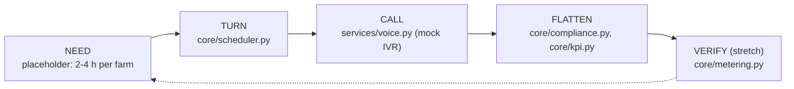

# Architecture

The prototype follows the deck's loop (slide 3): NEED, TURN, CALL, FLATTEN, VERIFY.

## Layout
- `backend/waragrid/config.py`: constants, defaults, input bounds, languages (one source of truth).
- `backend/waragrid/core/`: `pumps` (fleet, solar profile), `scheduler` (baseline vs randomised capped turns), `compliance`, `kpi`, `metering` (pooled-metering decoder), `impact`, `simulator` (one run, whole payload).
- `backend/waragrid/services/voice.py`: call scripts (en, hi, pa, mr) and mock IVR / WhatsApp channels.
- `backend/waragrid/api/`: `routes.py` (JSON endpoints), `validation.py` (bounds, clear 400s).
- `frontend/`: `index.html`, `css/` (tokens and layout), `js/` (`api`, `charts`, `panels`, `voice`, `main`). No build step; ES modules.
- `backend/tests/`: scheduler, energy-conservation, decoder and API contract tests.

## API
| Endpoint | Purpose |
|---|---|
| `GET /api/health` | Liveness and version |
| `GET /api/meta` | Defaults, bounds, languages |
| `GET /api/run?n&q&capf&solar&dt&save&head&eff&rs&ef&seed` | One simulated morning: both regimes, KPIs, turns with scripts, decoder, impact. Bad input returns 400 with a message |

## Extending
Need engine: replace the random 2-4 h in `core/simulator.py` with crop, rain and evapotranspiration. Real data: feed feeder CSVs into `kpi` and `metering`. Channels: implement `send` in `services/voice.py` with Twilio or the WhatsApp Cloud API. Storage: add Postgres for turns and swap logs.

## v0.3 additions
- Backend: `scenarios.py` (weather days, presets), `core/need.py` (crop demand to pump blocks), `core/montecarlo.py`, `core/verify.py`, `core/sensitivity.py`, `core/swaps.py`. Identical scenarios are served from an LRU cache and every response carries a `Server-Timing` header.
- Frontend: `js/state.js` (scenario state, localStorage, shareable links), `js/router.js` (hash views), `js/views.js`, `js/charts_extra.js`, `css/shell.css`. Four views: Overview, Farmers, Verify, Assumptions.

| Endpoint | Purpose |
|---|---|
| `GET /api/montecarlo` | 90% intervals for the headline KPIs over 24 mornings |
| `GET /api/verify?heat=` | Stepped rollout with a control feeder: planted saving vs before/after vs difference-in-differences |
| `GET /api/sensitivity?metric=` | Tornado of the impact assumptions |
| `GET /api/swap?a&b` | Press 2 to swap: approved only if the feeder stays under its cap; lists possible partners |
| `GET /api/export.csv` | Feeder curves for the current scenario |
| `GET /api/assumptions` | The assumption register as JSON (single source: docs/ASSUMPTIONS.md) |
